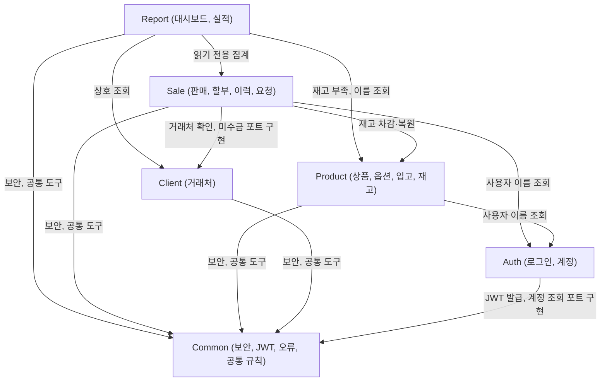

# 컴포넌트 설계: 미용 제품 판매 관리 (mirae-hair-lounge)

## 근거

- 요구사항: `inception/requirements-analysis/requirements.md` (FR1~FR10, NFR1~NFR12, 8절 남은 질문)
- 화면 설계: `inception/refined-mockups/mockups.md` (1절 할부·입금 변경, 3절 화면 목록, 7·8절 가정과 넘긴 항목)
- 작업 방식: `inception/practices-discovery/team-practices.md` (기능별 패키지 + `common`, 패키지 안에 controller/service/mapper, Thymeleaf, `127.0.0.1` 전용, H2 → MariaDB 전환 대비)
- 이 단계의 질문과 답: `inception/domain-design/domain-design-questions.md` (Q1~Q8, 사용자가 선택을 맡겨 추천안으로 정함)
- 결정 기록: `inception/domain-design/decisions.md` (ADR-001~ADR-010)
- 이 계획에는 User Stories 단계가 없어서 요구사항(FR)에 바로 연결했습니다.

이 문서는 직접 작성할 코드의 묶음(컴포넌트)과 각 묶음이 혼자 고치는 데이터(엔티티)를 정합니다. 데이터의 자료형, 길이, 허용 값은 Code Generation에서 정합니다. DB(H2, 나중에 MariaDB)는 컴포넌트가 아니라 컴포넌트가 쓰는 외부 의존입니다.

## 1. 컴포넌트 목록 (기계 판독용)

```yaml
components:
  - name: Common
    summary: 여러 기능이 함께 쓰는 보안 설정, JWT 쿠키 처리, 오류 처리, 금액·시간 규칙, 화면 공통 틀
    behaviour: >
      Spring Security 필터 체인을 구성한다. 로그인 화면과 정적 파일 외의 모든 요청은 JWT 쿠키가 있어야 하고,
      없거나 만료되었거나 서명이 틀리면 로그인 화면으로 보낸다(FR1.1, FR1.5). JWT는 HttpOnly, SameSite=Strict,
      Path=/ 쿠키에 담는다. 요청마다 토큰을 검사하고, 발급된 지 5분이 지난 토큰이면 새 토큰(만료 8시간)을 발급해
      쿠키를 바꾼다. 그래서 만료는 마지막 활동 후 8시간이다(ADR-006). 토큰 검사 때 계정이 사용 중인지
      확인하는데, 이 확인은 Common이 정의한 UserAccountLookup 포트로 하고 Auth가 구현한다(ADR-002).
      상태를 바꾸는 모든 요청(POST/PUT/DELETE, 로그인 폼 포함)은 Spring Security CSRF 토큰을 검사한다.
      토큰은 쿠키 저장소(CookieCsrfTokenRepository)를 쓰고, Thymeleaf 폼은 숨은 칸으로, $.ajax는
      X-XSRF-TOKEN 머리글로 보낸다(ADR-005). 권한은 URL 규칙과 서비스 메서드 권한 검사 두 겹으로 서버에서
      확인하고, 거부하면 "권한이 없습니다" 화면(S20)을 보여준다(FR1.4). 예상하지 못한 오류는 기술 내용 없이
      공통 오류 화면이나 알림 문구로 보여주고, 비밀번호·토큰·서명 키는 로그와 화면에 남기지 않는다(NFR3).
      금액은 0 이상의 원 단위 정수(long)로만 받고 부동소수점을 쓰지 않는다(FR2.6, NFR7). 오늘·이번 달은
      Asia/Seoul 기준 시계 하나에서 얻는다(NFR8). 목록은 20건 페이지이고 같은 정렬 값은 id 순으로 고정한다(FR10.4).
      JWT 서명 키는 환경변수로 받고 없으면 시작을 멈춘다.
    responsibilities:
      - 보안 필터 체인, URL 권한 규칙, JWT 쿠키 발급·검사·재발급, CSRF 설정
      - 공통 오류 처리(권한 없음, 찾을 수 없음, 서버 오류)와 입력 오류 표시 규칙
      - 금액(원 정수)·날짜(Asia/Seoul) 규칙과 시계, 페이지 처리
      - Thymeleaf 공통 화면 틀(왼쪽 메뉴, 알림 영역, 확인창 조각)과 역할별 메뉴 표시
      - 서버 바인드 주소, DB 접속 설정과 프로필 분리(H2 파일/메모리, 나중에 MariaDB)
    depends_on: []
    dependents:
      - component: Auth
        interaction: JWT 발급 도구와 현재 사용자 정보, UserAccountLookup 포트 구현
      - component: Product
        interaction: 보안 규칙, 금액·시계·페이지 도구, 공통 화면 틀
      - component: Client
        interaction: 보안 규칙, 페이지 도구, 공통 화면 틀
      - component: Sale
        interaction: 보안 규칙, 금액·시계·페이지 도구, 공통 화면 틀
      - component: Report
        interaction: 보안 규칙, 금액·시계 도구, 공통 화면 틀
    external_dependencies:
      - name: Spring Security
        kind: other
        purpose: 필터 체인, CSRF, 권한 검사
      - name: JWT 라이브러리
        kind: other
        purpose: 토큰 서명과 검증
      - name: 환경변수
        kind: other
        purpose: JWT 서명 키
    entities: []

  - name: Auth
    summary: 로그인·로그아웃, 직원 계정, 비밀번호 변경, 첫 관리자 계정 생성
    behaviour: >
      아이디와 비밀번호를 BCrypt 해시와 비교해 로그인시키고 JWT 쿠키를 발급한다. 틀린 비밀번호와 사용 중지된
      계정은 같은 문구 "아이디 또는 비밀번호가 올바르지 않습니다"로 거부한다(FR1.1, FR1.3). 로그아웃은 쿠키를
      지운다(FR1.5). 앱이 시작될 때 관리자 계정이 하나도 없으면 환경변수의 아이디와 비밀번호로 관리자를
      만들고, 환경변수가 없으면 변수 이름을 알리며 시작을 멈춘다(FR1.2). 관리자는 직원 계정을 만들고(아이디
      중복 불가, 초기 비밀번호 8자 이상), 사용 중지하고, 다시 사용하게 한다. 자기 자신의 관리자 계정은 사용
      중지할 수 없다(FR1.3). 비밀번호 변경은 현재 비밀번호가 맞고 새 비밀번호가 8자 이상일 때만 된다(FR1.6).
      Common의 UserAccountLookup 포트를 구현해 토큰 검사 때 계정 상태와 역할을 알려준다.
    responsibilities:
      - 사용자 계정(관리자, 직원)과 역할, 사용 여부
      - 로그인, 로그아웃, 비밀번호 변경, 직원 계정 관리 화면(S01, S18, S19)
      - 첫 관리자 계정 생성
    depends_on:
      - component: Common
        interaction: JWT 쿠키 발급, CSRF가 걸린 폼, 공통 화면 틀
        style: sync
    dependents:
      - component: Product
        interaction: 입고 등록자·재고 변동 처리자 이름을 읽기 전용으로 조회
      - component: Sale
        interaction: 판매 등록자·요청자·승인자·이력 처리자 이름을 읽기 전용으로 조회
    external_dependencies:
      - name: H2 (나중에 MariaDB)
        kind: database
        purpose: 사용자 계정 저장
      - name: 환경변수
        kind: other
        purpose: 첫 관리자 아이디와 비밀번호
    entities:
      - name: UserAccount
        identifier: id
        attributes: [id, loginId, name, passwordHash, role, enabled, createdAt]

  - name: Product
    summary: 분류, 상품, 옵션, 입고, 옵션별 현재 재고와 재고 변동 내역
    behaviour: >
      관리자는 분류(이름 중복 불가), 상품, 옵션을 등록·수정하고 판매 중지·재개로 바꾼다. 삭제는 없다(FR2.1~FR2.5).
      옵션명은 상품 안에서, 바코드는 전체에서 중복될 수 없다. 옵션 없이 저장한 상품에는 "기본" 옵션을 만든다.
      옵션 판매가·매입가를 비우면 상품 기본값을 쓴다(FR2.2). 재고는 옵션마다 현재 재고 숫자(currentStock)를
      두고, 바뀔 때마다 같은 트랜잭션에서 변동 내역(StockMovement) 한 줄을 남긴다(Q2, ADR-004). 재고를 줄일 때는
      "현재 재고가 줄일 수량 이상일 때만 줄이기"를 UPDATE 한 번으로 하고, 바뀐 행이 0이면 재고 부족으로
      알린다. 그래서 동시에 팔아도 재고가 0보다 작아지지 않는다(NFR6). 입고 등록은 재고를 늘리고(FR3.1),
      입고 취소는 재고를 줄이며 재고가 모자라면 거부하고, 취소한 입고는 "취소" 상태로 남는다(FR3.2).
      현재 재고가 최소 재고 이하이면 "재고 부족"이다(FR3.5). 재고 변동 구분은 RECEIPT(입고), RECEIPT_CANCEL(입고
      취소), SALE(판매), SALE_CANCEL(판매 취소), SALE_EDIT(판매 수정) 다섯 가지다(FR3.6). Sale이 판매·취소·수정 때
      부르는 재고 조정 기능(StockService: decrease, increase)을 제공한다.
    responsibilities:
      - 분류·상품·옵션 관리 화면(S03, S04, S05)
      - 입고 등록·취소와 입고 이력(S06)
      - 옵션별 현재 재고, 재고 부족 판단, 재고 변동 내역(S07)
      - 판매용 품목 검색(판매 중 상품의 판매 중 옵션, 재고 표시)과 재고 조정 기능 제공
    depends_on:
      - component: Common
        interaction: 보안 규칙, 금액·시계·페이지 도구, 공통 화면 틀
        style: sync
      - component: Auth
        interaction: 입고 등록자·재고 변동 처리자 이름 표시(읽기 전용 조회)
        style: sync
    dependents:
      - component: Sale
        interaction: 판매 등록·수정·취소 때 옵션 재고 차감·복원, 판매 단가·매입가 조회, 품목 추가 창 검색
      - component: Report
        interaction: 재고 부족 옵션, 상품·분류 이름으로 실적 묶기(읽기 전용 조회)
    external_dependencies:
      - name: H2 (나중에 MariaDB)
        kind: database
        purpose: 분류·상품·옵션·입고·재고 변동 저장
    entities:
      - name: Category
        identifier: id
        attributes: [id, name, createdAt]
      - name: Product
        identifier: id
        attributes: [id, name, categoryId, brand, basePrice, baseCost, active, createdAt, updatedAt]
        references:
          - entity: Category
            owned_by: Product
            relationship: 상품 하나는 분류 하나에 속한다
      - name: ProductOption
        identifier: id
        attributes: [id, productId, name, barcode, price, cost, minStock, currentStock, active, createdAt, updatedAt]
        references:
          - entity: Product
            owned_by: Product
            relationship: 옵션 하나는 상품 하나에 속한다
      - name: StockReceipt
        identifier: id
        attributes: [id, optionId, quantity, unitCost, receivedOn, memo, status, createdBy, createdAt, cancelledBy, cancelledAt]
        references:
          - entity: ProductOption
            owned_by: Product
            relationship: 입고 한 건은 옵션 하나의 재고를 늘린다
          - entity: UserAccount
            owned_by: Auth
            relationship: 입고와 입고 취소를 한 사용자
      - name: StockMovement
        identifier: id
        attributes: [id, optionId, movementType, delta, stockAfter, receiptId, saleId, actorId, occurredAt]
        references:
          - entity: ProductOption
            owned_by: Product
            relationship: 변동 한 줄은 옵션 하나의 재고 변화다
          - entity: StockReceipt
            owned_by: Product
            relationship: 입고·입고 취소 변동은 그 입고 건을 가리킨다
          - entity: Sale
            owned_by: Sale
            relationship: 판매·판매 취소·판매 수정 변동은 그 판매를 가리킨다(번호만 저장)
          - entity: UserAccount
            owned_by: Auth
            relationship: 변동을 일으킨 사용자

  - name: Client
    summary: 거래처(미용실) 등록·수정·거래 중지와 목록·상세 화면
    behaviour: >
      관리자는 거래처를 등록·수정하고 거래 중지·재개로 바꾼다. 삭제는 없다(FR4.1, FR4.4). 같은 상호가 있으면
      경고하되 "그래도 등록"으로 저장할 수 있다(FR4.1). 직원은 조회만 한다. 거래 중지된 거래처는 새 판매에서
      고를 수 없다(FR4.4). 거래처 목록(S08)의 미수금 합계·연체 여부와 거래처 상세(S10)의 판매 내역·구매 합계·
      미수금·할부 일정은 Client가 정의한 ClientSalesSummary 포트로 가져오고, 이 포트는 Sale이 구현한다(ADR-002).
      판매 등록·수정 때 Sale이 거래처가 있고 거래 중인지 확인하는 기능(ClientService.requireActive)을 제공한다.
    responsibilities:
      - 거래처 정보와 거래 여부
      - 거래처 목록·등록·수정·상세 화면(S08, S09, S10)
      - 거래처 존재·거래 중 확인 기능 제공
    depends_on:
      - component: Common
        interaction: 보안 규칙, 페이지 도구, 공통 화면 틀
        style: sync
    dependents:
      - component: Sale
        interaction: 판매 때 거래처 확인과 상호 표시, ClientSalesSummary 포트 구현
      - component: Report
        interaction: 연체 판매·실적 화면의 상호 표시(읽기 전용 조회)
    external_dependencies:
      - name: H2 (나중에 MariaDB)
        kind: database
        purpose: 거래처 저장
    entities:
      - name: Client
        identifier: id
        attributes: [id, name, contactName, phone, address, memo, active, createdAt, updatedAt]

  - name: Sale
    summary: 판매 등록·수정·취소, 할부 회차와 입금, 변경 이력, 직원 요청과 승인, 미수금·연체 판단
    behaviour: >
      판매 한 건은 품목(옵션, 수량, 판매 당시 단가·매입가)과 판매 일시(미래 불가), 거래처(없으면 "거래처 없음"),
      결제 수단(현금, 카드, 계좌이체, 외상·할부), 할인(금액 또는 비율 하나, 원 미만 버림), 메모로 된다(FR5.1~FR5.5).
      같은 옵션은 한 줄로 합친다. 판매 금액 = 품목 합계 - 할인. 외상·할부는 거래 중인 거래처가 있을 때만 된다.
      저장은 하나의 트랜잭션에서 판매·품목·회차·이력을 쓰고 Product의 재고 차감을 부르며, 한 품목이라도
      모자라면 전체를 되돌리고 모자라는 옵션과 현재 재고를 알린다(FR3.3, NFR5). 화면이 만든 요청 토큰
      (requestToken)을 판매에 유일 값으로 저장해 같은 요청이 두 번 와도 한 건만 만든다(FR5.6). 판매 번호는
      "S-" 뒤에 id를 4자리 이상으로 채워 보여준다(S-0123). 외상·할부는 개월 수(1~36)로 판매 금액을 똑같이
      나누고 끝전은 마지막 회차에 더한다. 첫 예정일은 판매일과 같거나 뒤인 날짜만 받고(기본값 판매일의 다음 달
      같은 날), 다음 회차는 매달 같은 날, 없는 날은 그 달 마지막 날이다(화면 설계 1절, Q6, ADR-008). 입금은
      관리자가 가장 앞의 미입금 회차를 오늘 날짜로 회차 금액 전체 입금 처리하고, 입금 취소는 가장 뒤의 입금된
      회차만 된다(화면 설계 1절). 미수금 = 판매 금액 - 입금 합계, 0이면 "완납"(FR7.4). 오늘(Asia/Seoul)보다 앞선
      예정일의 미입금 회차가 있으면 "연체"이고 예정일 당일은 연체가 아니다(FR7.5). 관리자의 수정·취소는 바로
      반영하고, 재고 차이만큼 Product 재고를 조정하며 모자라면 거부한다(FR3.4, FR6.1). 금액이 바뀐 할부 판매는
      (새 판매 금액 - 입금 합계)를 미입금 회차에 다시 똑같이 나눈다. 남은 금액이 음수이면 거부, 0이면 미입금
      회차를 모두 없애고 완납으로 보며, 0보다 크지만 미입금 회차 수보다 작으면(0원 회차가 생기면) 거부한다(Q5,
      ADR-008). 입금이 있으면 개월 수, 결제 수단, 첫 예정일을 바꿀 수 없다. 입금이 있는 판매는 입금을 먼저 취소해야
      판매를 취소할 수 있다(FR6.5). 모든 수정·취소·입금·입금 취소·요청 반영은 바꾸기 전과 뒤 내용을 JSON 글로
      이력(SaleHistory)에 남기고 이력은 지우지 않는다(FR6.2, Q7, ADR-007). 직원은 수정 요청(바꾼 뒤 판매 내용
      전체를 JSON으로)과 취소 요청을 사유와 함께 보낼 수 있고, 한 판매에 대기 요청은 하나뿐이다(FR6.3). 요청만으로는
      아무것도 바뀌지 않는다. 관리자가 승인하면 승인 시점의 판매·재고·입금 상태로 위 규칙을 다시 적용해 반영하고,
      반영할 수 없으면 승인을 거부하고 이유를 보여준다. 거절은 사유가 필수다(FR6.4). 판매는 version 칸으로
      동시에 고치는 것을 막아, 그사이 다른 사람이 바꿨으면 "다른 사용자가 먼저 바꿨습니다"로 거부한다.
      취소된 판매는 남지만 실적·미수금·연체에서 빠진다(FR6.5).
    responsibilities:
      - 판매·품목·할인·결제 수단, 판매 목록·등록·상세·수정 화면(S11~S14)
      - 할부 회차 생성·재분배, 입금·입금 취소, 미수금·연체 판단
      - 변경 이력(지우지 않음)
      - 직원 수정·취소 요청, 관리자 승인·거절 화면(S15, S16)
      - ClientSalesSummary 포트 구현(거래처별 미수금·연체·판매 내역·할부 일정)
    depends_on:
      - component: Common
        interaction: 보안 규칙, 금액·시계·페이지 도구, 공통 화면 틀
        style: sync
      - component: Auth
        interaction: 등록자·요청자·승인자·이력 처리자 이름 표시(읽기 전용 조회)
        style: sync
      - component: Product
        interaction: 재고 차감·복원(같은 트랜잭션), 판매 단가·매입가와 판매 가능 여부 조회, 품목 검색
        style: sync
      - component: Client
        interaction: 거래처 존재·거래 중 확인과 상호 표시, ClientSalesSummary 포트 구현
        style: sync
    dependents:
      - component: Report
        interaction: 실적 집계, 대시보드의 오늘·이번 달 판매, 최근 판매, 연체 판매, 승인 대기 수, 내 요청 상태(읽기 전용 조회)
    external_dependencies:
      - name: H2 (나중에 MariaDB)
        kind: database
        purpose: 판매·품목·회차·이력·요청 저장
      - name: Jackson
        kind: other
        purpose: 요청 내용과 이력의 전·후 값을 JSON 글로 바꾸기
    entities:
      - name: Sale
        identifier: id
        attributes: [id, soldAt, clientId, paymentMethod, discountType, discountValue, discountAmount, itemsTotal, saleAmount, installmentMonths, memo, status, requestToken, version, createdBy, createdAt, cancelledBy, cancelledAt]
        references:
          - entity: Client
            owned_by: Client
            relationship: 판매 하나는 거래처 하나에 속하거나 거래처가 없다
          - entity: UserAccount
            owned_by: Auth
            relationship: 판매를 등록한 사용자, 취소한 사용자
      - name: SaleItem
        identifier: id
        attributes: [id, saleId, lineNo, optionId, quantity, unitPrice, unitCost, amount]
        references:
          - entity: Sale
            owned_by: Sale
            relationship: 품목 줄은 판매 하나에 속한다
          - entity: ProductOption
            owned_by: Product
            relationship: 품목 줄은 옵션 하나를 판다(판매 당시 단가·매입가를 복사해 둔다)
      - name: Installment
        identifier: id
        attributes: [id, saleId, seq, dueDate, amount, paidOn, paidBy]
        references:
          - entity: Sale
            owned_by: Sale
            relationship: 회차는 외상·할부 판매 하나에 속한다
          - entity: UserAccount
            owned_by: Auth
            relationship: 입금 처리한 관리자
      - name: SaleHistory
        identifier: id
        attributes: [id, saleId, eventType, actorId, changeRequestId, beforeJson, afterJson, occurredAt]
        references:
          - entity: Sale
            owned_by: Sale
            relationship: 이력 한 줄은 판매 하나의 변화다
          - entity: ChangeRequest
            owned_by: Sale
            relationship: 요청 승인으로 생긴 변경은 그 요청을 가리킨다
          - entity: UserAccount
            owned_by: Auth
            relationship: 바꾼 사용자
      - name: ChangeRequest
        identifier: id
        attributes: [id, saleId, requestType, reason, payloadJson, status, requestedBy, requestedAt, decidedBy, decidedAt, rejectReason]
        references:
          - entity: Sale
            owned_by: Sale
            relationship: 요청은 판매 하나에 대한 수정 또는 취소다
          - entity: UserAccount
            owned_by: Auth
            relationship: 요청한 직원과 처리한 관리자

  - name: Report
    summary: 대시보드와 판매 실적(기간별, 상품·옵션별, 분류별, 결제 수단별, 이익)
    behaviour: >
      다른 컴포넌트의 데이터를 읽기만 하고 쓰지 않는다(ADR-003). 실적은 판매 일시(Asia/Seoul) 기준이며 외상·할부도
      판매 일시에 매출로 넣고, 시작일과 종료일을 모두 포함한다(FR8.1). 취소된 판매는 모든 실적에서 빠진다(FR8.6).
      상품별·분류별 표는 할인 전 품목 금액으로 묶고 아래에 할인 합계와 판매 금액 합계를 따로 보여준다(FR8.6).
      상품·옵션 순위는 금액, 수량, 상품명 순이다(FR8.2). 이익 = 판매 금액 - 판매 당시 매입가 x 수량 합계(FR8.4).
      기간에 판매가 없으면 "해당 기간 판매가 없습니다", 시작일이 종료일보다 늦으면 거부한다. 집계는 DB에서
      GROUP BY로 하고 판매 1만 건에서 2초 안에 열리게 판매 일시·상태에 색인을 둔다(NFR10). 대시보드는 역할에
      따라 다르다: 관리자는 오늘·이번 달 판매 금액, 최근 판매 10건, 재고 부족, 연체 판매, 승인 대기 수를 보고,
      직원은 최근 판매 10건, 재고 부족, 자기 요청 상태를 보며 매출 합계와 연체 판매는 보지 않는다(FR9.1~FR9.3).
      실적 화면은 관리자 전용이다.
    responsibilities:
      - 대시보드 화면(S02)
      - 판매 실적 화면(S17)
    depends_on:
      - component: Common
        interaction: 보안 규칙, 금액·시계 도구, 공통 화면 틀
        style: sync
      - component: Sale
        interaction: 판매·품목·회차·요청을 읽기 전용으로 집계·조회
        style: sync
      - component: Product
        interaction: 옵션·상품·분류 이름과 재고 부족 옵션을 읽기 전용으로 조회
        style: sync
      - component: Client
        interaction: 연체 판매와 최근 판매의 상호를 읽기 전용으로 조회
        style: sync
    dependents: []
    external_dependencies:
      - name: H2 (나중에 MariaDB)
        kind: database
        purpose: 읽기 전용 집계 조회
    entities: []
```

## 2. 컴포넌트 그림



<!-- Text fallback: 화살표는 "부른다"는 뜻이다. Report는 Sale, Product, Client, Common을 읽기 전용으로 부른다. Sale은 Product(재고), Client(거래처 확인), Auth(이름), Common을 부른다. Product는 Auth(이름)와 Common을, Client는 Common을, Auth는 Common을 부른다. Common은 아무것도 부르지 않는다. 의존은 한 방향이고 순환이 없다. -->

## 3. 컴포넌트 요약

| 컴포넌트 | 목적 | 부르는 컴포넌트 | 부르는 쪽 | 가진 엔티티 |
|---|---|---|---|---|
| Common | 보안 설정, JWT 쿠키, CSRF, 오류 처리, 금액·시간 규칙, 공통 화면 틀 | 없음 | Auth, Product, Client, Sale, Report | 없음 |
| Auth | 로그인·로그아웃, 직원 계정, 비밀번호 변경, 첫 관리자 | Common | Product, Sale | UserAccount |
| Product | 분류·상품·옵션, 입고, 현재 재고와 변동 내역 | Common, Auth | Sale, Report | Category, Product, ProductOption, StockReceipt, StockMovement |
| Client | 거래처 관리와 목록·상세 | Common | Sale, Report | Client |
| Sale | 판매, 할부·입금, 변경 이력, 요청·승인, 미수금·연체 | Common, Auth, Product, Client | Report | Sale, SaleItem, Installment, SaleHistory, ChangeRequest |
| Report | 대시보드, 판매 실적 | Common, Sale, Product, Client | 없음 | 없음 |

## 4. 엔티티 소유

| 엔티티 | 소유 컴포넌트 | 식별자 | 속성 | 참조 |
|---|---|---|---|---|
| UserAccount | Auth | id | id, loginId, name, passwordHash, role, enabled, createdAt | 없음 |
| Category | Product | id | id, name, createdAt | 없음 |
| Product | Product | id | id, name, categoryId, brand, basePrice, baseCost, active, createdAt, updatedAt | Category |
| ProductOption | Product | id | id, productId, name, barcode, price, cost, minStock, currentStock, active, createdAt, updatedAt | Product |
| StockReceipt | Product | id | id, optionId, quantity, unitCost, receivedOn, memo, status, createdBy, createdAt, cancelledBy, cancelledAt | ProductOption, UserAccount(Auth) |
| StockMovement | Product | id | id, optionId, movementType, delta, stockAfter, receiptId, saleId, actorId, occurredAt | ProductOption, StockReceipt, Sale(Sale), UserAccount(Auth) |
| Client | Client | id | id, name, contactName, phone, address, memo, active, createdAt, updatedAt | 없음 |
| Sale | Sale | id | id, soldAt, clientId, paymentMethod, discountType, discountValue, discountAmount, itemsTotal, saleAmount, installmentMonths, memo, status, requestToken, version, createdBy, createdAt, cancelledBy, cancelledAt | Client(Client), UserAccount(Auth) |
| SaleItem | Sale | id | id, saleId, lineNo, optionId, quantity, unitPrice, unitCost, amount | Sale, ProductOption(Product) |
| Installment | Sale | id | id, saleId, seq, dueDate, amount, paidOn, paidBy | Sale, UserAccount(Auth) |
| SaleHistory | Sale | id | id, saleId, eventType, actorId, changeRequestId, beforeJson, afterJson, occurredAt | Sale, ChangeRequest, UserAccount(Auth) |
| ChangeRequest | Sale | id | id, saleId, requestType, reason, payloadJson, status, requestedBy, requestedAt, decidedBy, decidedAt, rejectReason | Sale, UserAccount(Auth) |

엔티티 메모:

- 회차의 상태(입금 완료, 미입금, 연체)는 저장하지 않고 `paidOn`과 오늘 날짜로 계산합니다. 입금은 앞 회차부터만 되므로 입금된 회차는 늘 앞쪽에 모여 있습니다.
- 판매 번호(S-0123)는 저장하지 않고 `id`로 만듭니다. 승인 대기 상태도 저장하지 않고 대기 중인 `ChangeRequest`가 있는지로 판단합니다.
- 입금 취소는 회차의 `paidOn`, `paidBy`를 비우고 이력(SaleHistory)에 남깁니다.

## 5. 외부 의존

| 컴포넌트 | 의존 | 종류 | 용도 |
|---|---|---|---|
| Common | Spring Security | other | 필터 체인, CSRF, 권한 검사 |
| Common | JWT 라이브러리 | other | 토큰 서명과 검증 |
| Common | 환경변수 | other | JWT 서명 키 |
| Auth | H2 (나중에 MariaDB) | database | 사용자 계정 저장 |
| Auth | 환경변수 | other | 첫 관리자 아이디와 비밀번호 |
| Product | H2 (나중에 MariaDB) | database | 분류·상품·옵션·입고·재고 변동 저장 |
| Client | H2 (나중에 MariaDB) | database | 거래처 저장 |
| Sale | H2 (나중에 MariaDB) | database | 판매·품목·회차·이력·요청 저장 |
| Sale | Jackson | other | 요청 내용과 이력의 전·후 값을 JSON 글로 바꾸기 |
| Report | H2 (나중에 MariaDB) | database | 읽기 전용 집계 조회 |

## 6. 화면과 주소 확정

화면 설계 3절의 주소(안)를 그대로 확정합니다. 각 화면은 아래 컴포넌트의 controller가 맡습니다.

| 화면 | 주소 | 맡는 컴포넌트 |
|---|---|---|
| S01 로그인 | `/login`, `/logout` | Auth |
| S02 대시보드 | `/` | Report |
| S03 상품 목록, S04 상품 등록·수정 | `/products`, `/products/new`, `/products/{id}/edit` | Product |
| S05 분류 관리 | `/categories` | Product |
| S06 입고 목록·등록 | `/receipts` | Product |
| S07 재고 변동 내역 | `/products/{id}/options/{optionId}/stock` | Product |
| S08 거래처 목록, S09 등록·수정, S10 상세 | `/clients`, `/clients/new`, `/clients/{id}/edit`, `/clients/{id}` | Client |
| S11 판매 목록, S12 판매 등록, S13 판매 상세 | `/sales`, `/sales/new`, `/sales/{id}` | Sale |
| S14 판매 수정·수정 요청 | `/sales/{id}/edit`, `/sales/{id}/change-request` | Sale |
| S15 승인 요청, S16 내 요청 | `/approvals`, `/approvals/{id}`, `/my-requests` | Sale |
| S17 판매 실적 | `/reports` | Report |
| S18 직원 계정, S19 비밀번호 변경 | `/users`, `/account/password` | Auth |
| S20 권한 없음·찾을 수 없음·오류 | 공통 오류 화면 | Common |

화면 안의 버튼 요청(입금, 입금 취소, 승인, 거절, 품목 검색)은 같은 주소 아래의 POST 또는 GET 요청으로 두고, 정확한 경로는 Code Generation에서 정합니다.

## 7. 왜 이렇게 나눴는가

| 컴포넌트 | 따로 둔 이유 |
|---|---|
| Common | 모든 기능이 같은 보안 규칙·오류 처리·금액·시간 규칙을 써야 하고, 작업 방식이 공통 코드를 `common`에 두기로 했다. 엔티티가 없고 다른 컴포넌트를 부르지 않는다 |
| Auth | 계정과 비밀번호는 보안 규칙이 가장 엄격한 데이터라 혼자 고친다. 다른 기능과 바뀌는 이유가 다르다 |
| Product | 상품·옵션과 재고는 함께 바뀐다. 입고와 재고 변동이 모두 옵션의 현재 재고를 고치므로 한 컴포넌트가 재고 숫자를 혼자 고쳐야 음수 재고를 막을 수 있다(Q1 B) |
| Client | 거래처는 판매와 생명 주기가 다르고(먼저 등록, 거래 중지), 판매가 참조만 한다. 화면도 따로다(Q1 B) |
| Sale | 판매, 품목, 할부·입금, 이력, 요청은 한 판매의 금액과 상태를 함께 바꾸는 규칙(재분배, 입금 우선 취소, 승인 시 재계산)을 공유한다. 나누면 한 트랜잭션 안의 규칙이 여러 곳으로 흩어진다(Q1 B) |
| Report | 읽기만 하는 집계라 바뀌는 이유(새 실적 표, 성능)가 쓰기 규칙과 다르다. 데이터를 갖지 않는다 |

거절한 나누기(자세한 비교는 `decisions.md` ADR-001):

- Q1 A(입고·재고, 할부·입금, 요청을 각각 따로 둠): `installment`와 `approval`이 판매 금액·상태 규칙을 `sale`과 나눠 가져 서로를 불러야 하고, 1인 프로젝트에 패키지가 아홉 개로 많아진다.
- Q1 C(처음 정한 네 개만): 거래처가 `sale` 안에 들어가 거래처 화면과 판매 규칙이 한 패키지에 섞이고, `sale`이 너무 커진다.

## 8. 다음 단계로 넘기는 것

- 자료형, 길이, 허용 값, 색인, 테이블·칼럼 이름(snake_case), 정확한 버튼 요청 경로는 Code Generation에서 정합니다.
- Spring Boot, MyBatis, Gradle, JWT 라이브러리 버전은 Code Generation 계획에서 Java 25를 공식 지원하는 최신 안정판으로 고릅니다(Q8, ADR-009).
- 뼈대(walking skeleton)는 Common(보안·JWT·CSRF), Auth(로그인, 첫 관리자), Product(상품 1건 조회)만으로 만들 수 있습니다. 작업 방식대로 Code Generation 계획의 첫 단계로 둡니다.
