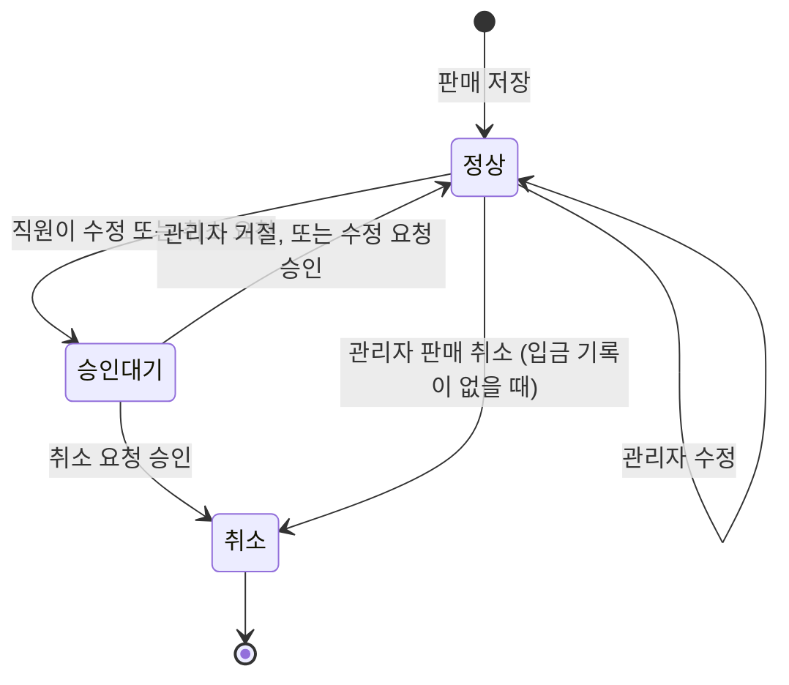
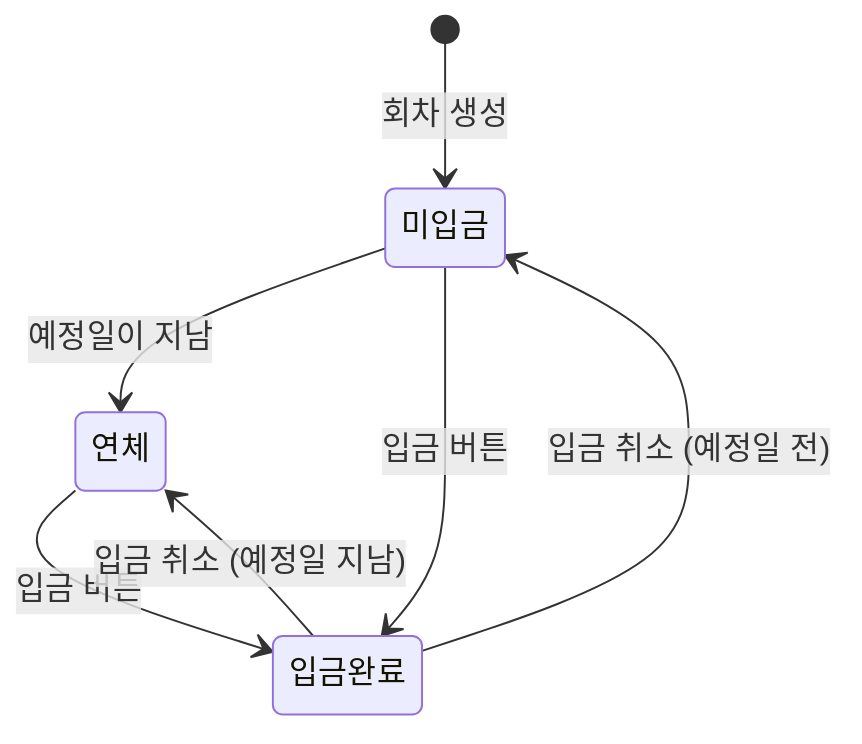

# 동작 명세: 미용 제품 판매 관리

> 근거: `inception/requirements-analysis/requirements.md`, `inception/practices-discovery/team-practices.md`, `inception/refined-mockups/refined-mockups-questions.md`(Q1~Q10). 화면 그림과 화면 ID(S01~S20)는 `mockups.md`에 있습니다. 컴포넌트 명세는 디자인 지식의 컴포넌트 명세 서식을 따랐고, 이 앱은 서버가 Thymeleaf로 그리는 화면이라 "속성(Props)"은 Thymeleaf 조각(fragment)에 넘기는 값으로 적었습니다.

## 1. 구현 방식 공통

- 화면은 서버가 Thymeleaf로 그리고, 화면별 JavaScript는 `static/js/<화면>.js` 정적 파일로 분리한다. 별도 프런트엔드 서버와 npm 빌드는 없다. [team-practices]
- 기본은 일반 폼 전송과 페이지 이동이다. 페이지를 바꾸지 않는 요청은 세 가지뿐이다: 품목 추가 창의 검색(S12-1), 할부 회차의 입금·입금 취소(S13), 거래처 선택 칸의 검색(S12). jQuery `$.ajax`로 보내고, 응답에 따라 해당 영역만 다시 그린다. [assumption]
- 판매 등록·수정 화면의 금액 합계, 할인, 할부 회차 계산은 화면 JavaScript가 미리 보여주기 위해 계산하고, 저장할 때 서버가 같은 규칙으로 다시 계산해 서버 값을 쓴다. [FR10.3] [NFR5]
- 모든 상태 변경 요청(폼 전송, `$.ajax` POST)은 CSRF 보호 값을 함께 보낸다. 구체적인 방식은 Domain Design에서 정한다. [NFR3]

## 2. 컴포넌트

### AppShell (공통 화면 틀)

| 항목 | 값 |
|---|---|
| 컴포넌트 | AppShell |
| 설명 | 위쪽 줄, 왼쪽 세로 메뉴, 알림 영역, 본문으로 된 모든 화면의 틀 [Q1] |
| 분류 | layout / navigation |

| 상태 | 설명 | 계기 |
|---|---|---|
| default | PC에서 메뉴가 펼쳐져 있음 | 화면 폭 992px 이상 |
| collapsed | 메뉴를 숨기고 "메뉴" 버튼 표시 | 화면 폭 991px 이하 |
| menu-open | 메뉴가 왼쪽에서 밀려 나옴(Bootstrap Offcanvas) | "메뉴" 버튼 클릭 |

| 값 | 형식 | 필수 | 기본 | 설명 |
|---|---|---|---|---|
| activeMenu | string | 예 | - | 현재 메뉴 키(`sales`, `products` 등). 굵게 표시하고 `aria-current="page"` |
| userName, role | string | 예 | - | 위쪽 줄 표시와 역할별 메뉴 결정 |
| pendingApprovalCount | number | 아니요 | 0 | 0보다 크면 "승인 요청" 옆에 숫자 배지(관리자만) |
| flash | object | 아니요 | - | 이동 후 보여줄 알림(종류, 문구) |

| 화면 폭 | 동작 |
|---|---|
| 767px 이하 | collapsed. 비밀번호 변경·로그아웃은 메뉴 맨 아래 |
| 768~991px | collapsed |
| 992px 이상 | default |

| 접근성 | 구현 |
|---|---|
| 역할 | `<header>`, `<nav aria-label="주 메뉴">`, `<main>` |
| 키보드 | Bootstrap Offcanvas 기본 동작(Esc로 닫기) |
| 화면 읽기 | 현재 메뉴에 `aria-current="page"` |

### DataList (목록 표 / 휴대폰 카드)

| 항목 | 값 |
|---|---|
| 컴포넌트 | DataList |
| 설명 | 목록 화면의 표. 767px 이하에서는 한 행이 카드 한 장이 된다 [Q2] |
| 분류 | display |

| 상태 | 설명 | 계기 |
|---|---|---|
| populated | 자료 표시, 아래에 페이지 이동 | 자료 있음 |
| empty | 표 대신 빈 상태 문구와 행동 버튼 | 자료 없음 |
| no-result | "조건에 맞는 …이 없습니다" + [조건 초기화] | 검색 조건 결과 없음 |
| muted-row | 회색 글씨 행(취소, 판매 중지, 거래 중지) | 상태 값 |

| 값 | 형식 | 필수 | 기본 | 설명 |
|---|---|---|---|---|
| columns | list | 예 | - | 열 제목과 값. 휴대폰 카드에서는 열 제목이 "항목명:" 라벨이 된다 |
| page | object | 예 | - | 전체 건수, 현재 페이지, 20건 단위 [FR10.4] |
| emptyMessage, emptyAction | string | 예 | - | 빈 상태 문구와 버튼 |

- 구현: PC는 `<table class="table">`, 휴대폰은 같은 행을 CSS로 카드처럼 보이게 하는 `.table-stack` 클래스(직접 만든 CSS, `design-system-mapping.md`). 행 하나를 두 번 그리지 않는다. [Q8] [assumption]
- 금액 열은 오른쪽 정렬. 정렬이 같은 행은 등록 순서. [FR10.4] [NFR7]
- 접근성: `<th scope="col">`, 표 위에 `<caption class="visually-hidden">`로 표 이름.

### SearchFilterBar (검색·필터 줄)

- 목록 위의 한 줄 폼. GET 전송이라 조건이 주소에 남고, 페이지 이동·새로고침·뒤로 가기에도 유지된다. [FR10.4] [assumption]
- 휴대폰에서는 검색 칸 하나와 [조건] 버튼만 보이고, 누르면 나머지 조건이 펼쳐진다(Bootstrap Collapse). [Q2]
- 엔터로 검색. [조건 초기화]는 기본 조건으로 되돌린다.

### StatusBadge (상태 배지)

| 값 | 글자 | 색 |
|---|---|---|
| 재고 부족 | "재고 부족" | 주황 |
| 연체 | "연체" | 빨강 |
| 완납 | "완납" | 초록 |
| 승인 대기 | "승인 대기" | 파랑 |
| 취소 / 판매 중지 / 거래 중지 / 사용 중지 | 해당 글자 | 회색 |
| 입금 완료 / 미입금 | 해당 글자 | 초록 / 회색 테두리 |

- 상태는 늘 글자로 쓰고 색은 덧붙이는 표시일 뿐이다. 색만 다른 배지는 없다. [FR3.5] [FR7.6] [Q3]
- 구현: Bootstrap `badge` + `text-bg-*`.

### FormField (입력 칸)

| 상태 | 설명 | 계기 |
|---|---|---|
| default | 라벨 위, 입력 칸 아래 | 화면 열림 |
| invalid | 빨간 테두리 + 칸 아래 오류 글자 | 칸을 벗어날 때 화면 검사 실패, 또는 서버 검사 실패로 다시 그려짐 |
| disabled | 꺼진 칸 + 옆에 이유 글자 | 바꿀 수 없는 조건(예: 입금 기록이 있어 개월 수 변경 불가) |

- 필수 칸은 라벨 뒤 `*`와 `required`. 오류 글자는 `invalid-feedback`이고 칸과 `aria-describedby`로 연결한다. [FR10.3] [Q3]
- 화면 검사는 칸을 벗어날 때(blur)와 저장할 때 한다. 입력하는 도중에는 검사하지 않는다. [assumption]
- 금액 칸은 숫자만 받고, 칸을 벗어나면 천 단위 쉼표로 보여준다. 전송할 때는 쉼표를 뺀 정수를 보낸다. [FR2.6] [NFR7]
- 서버가 오류로 화면을 다시 그릴 때 입력값을 채워 넣는다(비밀번호 칸 제외). [FR10.3]

### ConfirmDialog (확인창)

| 항목 | 값 |
|---|---|
| 설명 | 되돌리기 어려운 동작 전에 무엇이 바뀌는지 보여주는 창 [FR10.2] |
| 분류 | feedback |
| 쓰는 곳 | 판매 취소, 판매 중지, 거래 중지, 입고 취소, 입금, 입금 취소, 요청 승인·거절, 사용 중지, 판매 저장 전 확인(S12-2), 수정 저장 전 확인(S14) |

| 상태 | 설명 | 계기 |
|---|---|---|
| open | 제목, 바뀌는 내용, [돌아가기] [실행 버튼] | 동작 버튼 클릭 |
| submitting | 실행 버튼 꺼짐, "처리 중..." | 실행 버튼 클릭 |
| error | 창을 닫고 알림 영역에 이유 | 서버 거부 |

- 실행 버튼 문구는 동작 이름 그대로("판매 취소", "입금 처리")이고 "확인"이라고만 쓰지 않는다. 판매 취소, 입고 취소, 입금 취소, 사용 중지의 실행 버튼은 빨간색이다. [assumption]
- 구현: Bootstrap Modal 하나를 공통 조각으로 두고, 버튼의 `data-confirm-*` 값으로 제목과 내용을 채운다. Esc와 [돌아가기]로 닫히며 닫히면 누른 버튼으로 포커스가 돌아간다(Bootstrap 기본). 휴대폰에서는 화면 전체로 연다.
- 실행 버튼은 한 번 누르면 꺼져서 두 번 전송되지 않는다. [FR5.6]

### ProductPickerModal (품목 추가 창, S12-1) [Q4]

| 상태 | 설명 | 계기 |
|---|---|---|
| open | 검색 칸에 포커스, 첫 페이지 목록 | [+ 품목 추가] 클릭 |
| searching | 목록 자리에 "찾는 중..." | 검색·페이지 이동 |
| no-result | "조건에 맞는 품목이 없습니다" | 결과 없음 |
| error | "목록을 불러오지 못했습니다. [다시 시도]" | 요청 실패 |

| 값 | 형식 | 필수 | 기본 | 설명 |
|---|---|---|---|---|
| mode | `multi` \| `single` | 예 | `multi` | 판매는 여러 개 체크, 입고(S06)는 한 개 선택 |
| includeInactive | boolean | 아니요 | false | 입고에서는 true(판매 중지 옵션도 보임) [assumption] |

- 체크한 옵션은 창 안에 기억되어 페이지를 넘겨도 유지되고, 아래에 "n개 선택됨"을 보여준다.
- 재고 0인 옵션은 판매 모드에서 체크 칸이 꺼진다. [FR3.3]
- [선택한 품목 추가]를 누르면 SaleItemsTable에 줄을 더하고 창을 닫는다.

### SaleItemsTable (판매 품목 표, S12·S14)

- 줄: 상품 - 옵션, 재고, 수량(정수 1 이상), 단가(옵션 판매가, 바꿀 수 없음), 금액, [빼기]. [FR5.1]
- 수량을 바꾸면 금액 → 품목 합계 → 할인 → 판매 금액 → 할부 회차 순서로 바로 다시 계산한다.
- 같은 옵션을 다시 넣으면 기존 줄 수량에 더한다. 수량이 재고보다 많으면 재고 칸을 "재고 부족(현재 n)"으로 바꾼다. [FR3.3]
- 품목이 하나도 없으면 "품목을 추가하세요."를 보여주고 [저장]을 눌렀을 때 "품목을 하나 이상 넣어 주세요"를 보여준다. [assumption]

### InstallmentSchedule (할부 일정, S12·S13·S14) [Q7] [Q9] [Q10]

| 상태 | 설명 | 계기 |
|---|---|---|
| hidden | 보이지 않음 | 결제 수단이 외상·할부가 아님 |
| preview | 개월 수·첫 예정일 입력 + 계산된 회차 표(읽기 전용) | 판매 등록·수정에서 외상·할부 선택 |
| detail | 요약 줄 + 회차 표 + 입금·입금 취소 버튼 | 판매 상세 |
| fully-paid | "완납" 배지, [입금] 없음 | 모든 회차 입금 |
| cancelled | 버튼 없이 표만 회색 | 판매 취소됨 |

| 값 | 형식 | 필수 | 기본 | 설명 |
|---|---|---|---|---|
| saleAmount | number | 예 | - | 판매 금액 |
| months | number | 예 | - | 1~36 [assumption] |
| firstDueDate | date | 예 | 판매일 다음 달 같은 날 | 바꿀 수 있음 [assumption] |
| rows | list | detail에서 예 | - | 회차, 예정일, 금액, 상태, 입금일 |
| canPay | boolean | 예 | - | 관리자이고 취소되지 않은 판매 |

- 분배: 금액 = 판매 금액 ÷ 개월 수(원 미만 버림), 끝전은 마지막 회차. 예정일은 매달 같은 날, 없는 날짜는 그 달 마지막 날. [FR7.1] [Q9]
- 수정에서 판매 금액이 바뀌면 입금된 회차는 그대로 두고, (새 판매 금액 − 입금 합계)를 미입금 회차에 같은 방식으로 다시 나눈다. [Q10]
- 요약 줄: 판매 금액, 입금 합계, 남은 금액, 연체 금액과 가장 오래된 연체 예정일. [FR7.4] [FR7.6] [Q7]
- [입금]은 가장 앞의 미입금 회차 줄에만, [입금 취소]는 가장 뒤의 입금된 회차 줄에만 있다. 둘 다 ConfirmDialog를 거쳐 `$.ajax` POST로 보내고, 성공하면 서버가 다시 그린 일정 영역(Thymeleaf 조각)으로 바꿔 끼운다. 알림 영역에 "2회차 입금을 처리했습니다."를 보여준다. [Q9] [Q10] [assumption]
- 같은 회차를 두 사람이 동시에 입금 처리하면 서버는 하나만 받아들이고, 늦은 쪽에는 "이미 처리된 회차입니다. 화면을 새로 고칩니다."를 보여준 뒤 일정 영역을 다시 그린다. [NFR6] [assumption]
- 접근성: 회차 표는 `<table>`, 버튼에는 `aria-label="2회차 입금 처리"`처럼 회차 번호를 넣는다.

### DiffView (바뀐 내용 비교, S14 확인창·S15) [Q6]

- 세 열: 항목, 지금, 요청한 내용(또는 바꾼 뒤). 바뀐 줄은 굵은 글씨 + 연한 노란 배경 + "(바뀜)" 글자. [Q3]
- 바뀌지 않은 항목은 접혀 있고 [모든 항목 보기]로 펼친다(Bootstrap Collapse). [assumption]
- 할부 판매는 회차 금액 변화도 줄로 보여준다.

### FlashAlert (알림 영역)

- 종류: 성공(초록), 오류(빨강), 안내(파랑). 앞에 "완료", "오류", "안내" 글자를 붙인다. 닫기 버튼이 있고 자동으로 사라지지 않는다. [assumption]
- 페이지 이동 후 알림은 서버가 한 번만 보여준다(redirect 후 flash). 페이지를 바꾸지 않는 요청의 결과도 같은 영역에 넣는다.
- 접근성: 오류는 `role="alert"`, 성공·안내는 `role="status"`.

## 3. 주요 사용자 흐름

```
Flow: 로그인
Persona: 관리자, 직원
Trigger: 로그인하지 않은 채 아무 화면이나 엶
Steps:
  1. 로그인 화면(S01) -> 아이디·비밀번호 입력 후 [로그인] -> 서버가 확인
  2. 성공 -> 원래 열려던 화면, 없으면 대시보드(S02)
Success outcome: 역할에 맞는 메뉴가 있는 대시보드
Error paths:
  - 틀림 또는 사용 중지 계정 -> "아이디 또는 비밀번호가 올바르지 않습니다" -> 다시 입력
  - 로그인 만료 -> S01 + "로그인 시간이 지나 다시 로그인해 주세요." -> 로그인 후 원래 화면
```

```
Flow: 판매 등록 (외상·할부 포함)
Persona: 관리자, 직원
Trigger: 메뉴의 "판매 등록" 또는 판매 목록의 [+ 판매 등록]
Steps:
  1. S12 -> 거래처 선택(선택 사항) -> 거래처를 고르면 "외상·할부"가 켜짐
  2. S12 -> [+ 품목 추가] -> S12-1에서 옵션 체크 -> [선택한 품목 추가] -> 품목 표에 수량 1로 추가
  3. S12 -> 수량·할인 입력 -> 합계와 판매 금액이 바로 바뀜
  4. S12 -> 결제 수단 "외상·할부" -> 개월 수·첫 예정일 입력 -> 회차 표 자동 계산
  5. S12 -> [저장] -> 화면 검사 통과 -> S12-2 저장 전 확인창
  6. S12-2 -> [저장] -> 서버가 재고 확인·차감, 판매·회차 저장(한 트랜잭션)
Success outcome: 판매 상세(S13) + "판매 S-0123을 저장했습니다."
Error paths:
  - 화면 검사 실패(수량, 할인, 미래 날짜) -> 칸 아래 오류 -> 고친 뒤 다시 저장
  - 재고 부족 -> 확인창을 닫고 S12 위에 "7N 재고 부족(현재 2)" -> 수량을 줄이거나 품목을 뺌
  - 버튼 두 번 클릭 -> 두 번째 요청은 같은 판매로 처리되어 한 건만 생김 [FR5.6]
```

```
Flow: 할부 회차 입금 처리
Persona: 관리자
Trigger: 판매 상세(S13), 대시보드의 연체 줄, 거래처 상세의 할부 일정
Steps:
  1. S13 -> 가장 앞의 미입금 회차 줄의 [입금] -> 확인창 "2회차 53,100원을 오늘 입금으로 처리할까요?"
  2. 확인창 -> [입금 처리] -> 서버가 그 회차를 오늘 날짜로 입금 처리, 이력 기록
Success outcome: 회차 상태 "입금 완료 (오늘)", 요약 줄의 입금 합계·남은 금액·연체가 다시 계산됨. 마지막 회차면 "완납"
Error paths:
  - 다른 사람이 먼저 처리 -> "이미 처리된 회차입니다. 화면을 새로 고칩니다." -> 일정 영역 다시 그림
  - 잘못 누름 -> 그 회차 줄의 [입금 취소] -> 확인창 -> 미입금으로 돌아감 [FR7.3]
  - 판매가 취소됨 -> 버튼 없음
```

```
Flow: 직원의 수정·취소 요청과 관리자 승인
Persona: 직원(요청), 관리자(승인)
Trigger: 직원이 판매 상세(S13)에서 [수정 요청] 또는 [취소 요청]
Steps:
  1. 직원 S13 -> [수정 요청] -> S14(요청 모드)에서 값 수정 + 사유 입력 -> [요청 보내기] -> 바뀌는 항목 확인창 -> 요청 저장(판매는 그대로)
     또는 S13 -> [취소 요청] -> 사유 입력 창 -> [요청 보내기]
  2. 관리자 메뉴 "승인 요청 (n)" 또는 대시보드 "승인 대기" -> S15 목록 -> 한 건 열기 -> 비교 화면
  3. 관리자 -> [승인] -> 확인창 -> 서버가 승인 시점 재고로 반영(FR3.4) / 또는 [거절] -> 사유 입력
  4. 직원 -> 판매 상세 결과 줄, 내 요청(S16), 대시보드 "내 요청"에서 결과 확인
Success outcome: 승인이면 판매가 바뀌고 이력에 "요청 김OO · 승인 홍길동", 거절이면 판매 그대로 + 거절 사유가 직원에게 보임
Error paths:
  - 대기 요청이 이미 있음 -> 직원 버튼이 꺼져 있고 "승인을 기다리는 요청이 있습니다"
  - 승인 시 재고 부족이나 입금된 금액보다 작아짐 -> 승인되지 않고 이유 표시 -> 관리자가 거절하거나 재고 입고 후 다시 승인
  - 거절 사유 비어 있음 -> "거절 사유를 입력하세요"
```

## 4. 판매와 요청의 상태 변화



<!-- Text fallback: 판매는 저장되면 "정상"이다. 직원이 수정이나 취소를 요청하면 "승인 대기"가 된다. 관리자가 거절하거나 수정 요청을 승인하면 다시 "정상", 취소 요청을 승인하면 "취소"가 된다. 관리자는 정상인 판매를 바로 수정하거나(정상 유지), 입금 기록이 없을 때 취소할 수 있다. 취소된 판매는 더 바뀌지 않는다. "승인 대기"는 화면 표시용 상태이며, 실제로 판매 자체의 상태로 둘지 요청의 상태로 둘지는 Domain Design에서 정한다. -->



<!-- Text fallback: 할부 회차는 만들어지면 "미입금"이다. 예정일이 지나도록 입금되지 않으면 "연체"로 보인다. 미입금이나 연체 회차는 입금 버튼으로 "입금 완료"가 된다. 입금을 취소하면 예정일이 아직이면 "미입금", 지났으면 "연체"로 돌아간다. 연체는 날짜로 계산되는 표시이며 저장되는 값이 아니다(FR7.5). -->

## 5. 키보드와 포커스 (기본 수준) [Q3]

접근성 수준은 "기본만"으로 정했지만(Q3), Bootstrap과 기본 HTML이 주는 동작은 유지한다.

- 화면을 열면 포커스는 문서 처음에 있고, 폼 화면은 첫 입력 칸에 커서를 둔다. [assumption]
- 창(모달)은 열리면 창 안 첫 칸으로, 닫히면 연 버튼으로 포커스가 간다(Bootstrap 기본).
- 저장에 실패하면 첫 오류 칸으로 포커스를 옮긴다. [assumption]
- `outline: none`으로 포커스 표시를 지우지 않는다.
